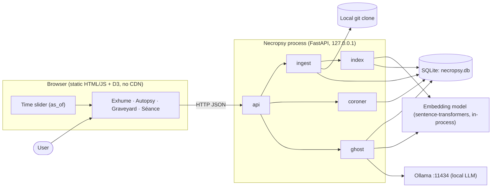
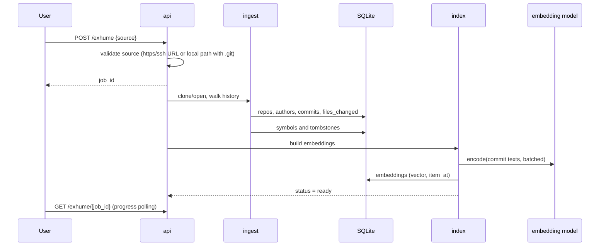
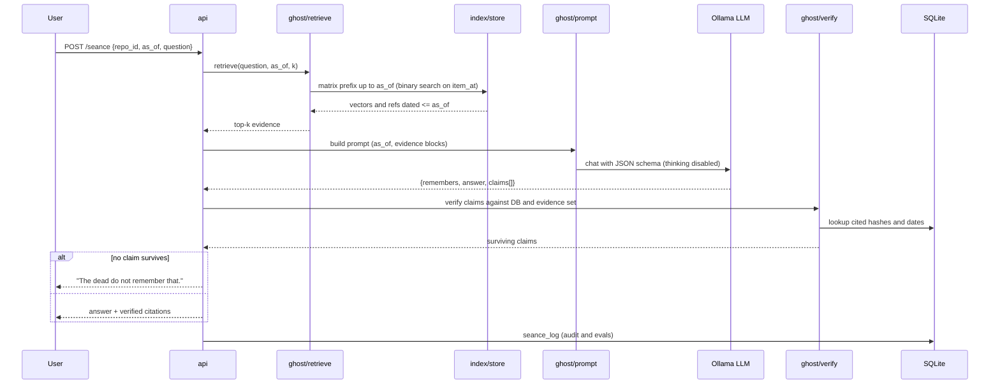

# Necropsy: Architecture

**Status:** Draft v0.1 · **Date:** 2026-10-31 · Companion docs: `PRD.md`, `TRD.md`, `DATA_SCHEMA.md`

---

## 1. Overview

Necropsy is a single local process (FastAPI) plus a static browser UI. It reads a Git repository, stores facts in SQLite, indexes commit text as embeddings, and answers questions through a local LLM served by Ollama. The architecture is organized around one invariant:

> **Time-travel invariant:** nothing dated after the selected `as_of` date may reach the LLM, the verifier, or any displayed statistic.

Everything below exists to make that invariant true *by construction*, not by remembering to filter.

## 2. System context

**Trust boundary:** the Git repo contents are *untrusted data*. They are read, never executed. The only network access in normal operation is the initial `git clone` and one-time model downloads.

## 3. Components

| Component | Responsibility | Depends on |
|---|---|---|
| `ingest/git.py` | Clone/open repo; extract commits, authors (hashed emails), changed files; flag bots | git, SQLite |
| `ingest/symbols.py` | tree-sitter symbol lifecycles; file and symbol tombstones | git, tree-sitter, SQLite |
| `ingest/issues.py` (P2) | Import cached issue data | SQLite |
| `index/embed.py` | Build embedding text per item; embed in batches | embedding model |
| `index/store.py` | Persist vectors; load a date-sorted matrix per repo; prefix slicing by date | SQLite, NumPy |
| `coroner/*` | Deterministic analytics: activity, last gasp, time of death, bus factor, decline onset; eras (display only) | SQLite, scikit-learn, UMAP |
| `ghost/retrieve.py` | `retrieve(query, as_of, k)` over the date-prefix slice | index/store |
| `ghost/prompt.py` | Build system prompt and evidence blocks | retrieve |
| `ghost/llm.py` | Ollama client with JSON-schema output, retry, timeout | Ollama |
| `ghost/verify.py` | Citation verification and claim pruning | SQLite, embeddings |
| `api/server.py` | Endpoints, input validation, job tracking | all of the above |
| `evals/*` | Ground-truth question generation and scoring across models | ghost, SQLite |
| `web/*` | Static UI, slider, D3 charts | API |

Modules depend downward only (UI → api → ghost/coroner → index → storage). Nothing in `ingest` imports `ghost`.

## 4. Data flow

### 4.1 Exhume (ingest and index)

### 4.2 Séance (the time-filtered question)

### 4.3 Autopsy and graveyard
These read straight from SQLite with an `as_of` parameter. No LLM is involved except for optional era labels and the resurrection plan narrative.

## 5. How the invariant is enforced

| Layer | Mechanism |
|---|---|
| **Storage** | Every time-bearing row has a UTC date column that is indexed; vectors are stored with `item_at` |
| **Retrieval** | The in-memory matrix is **sorted by `item_at`**; the `as_of` filter is a prefix slice found by binary search, so later items are not in the slice that is scored |
| **Prompt** | The evidence list comes only from retrieval; no other repo text is added; the as-of date is stated in the prompt |
| **Verification** | Cited hashes must be in the evidence set **and** dated ≤ `as_of`; otherwise the claim is dropped |
| **Statistics** | Every analytic is a function of `(repo_id, as_of)`; none caches a full-history result without the date in its key |
| **Eras** | Clusters use all history, so they are a **display-only** layer; labels and summaries are never given to the ghost |
| **Tests** | A mandatory date-leak test builds a fixture repo with known dates and asserts every layer above for several `as_of` values |

**Date semantics:** `as_of` is interpreted as the end of that day in UTC. Items use `authored_at` for filtering.

**Known edge cases:** commits with future or skewed author dates; repos with rewritten history; the date a symbol "died" is the commit date of the removal, not when the developer decided to remove it.

## 6. Local and offline strategy

- **Models:** pulled once with `ollama pull`; embeddings downloaded once and cached by sentence-transformers. After that, no network is needed.
- **Frontend:** D3 and fonts are vendored into `web/vendor/`. No CDN requests at runtime.
- **Git:** `clone` is the only network step. A local path works with no network at all.
- **Issues (P2):** fetched once and cached as JSON; the app reads only the cache.
- **Verification of offline claim:** the demo and a CI-style check run with the network disabled after clone.

## 7. Configuration and swappability

Model names live only in `config.py` (overridable by environment variables). Swapping `LLM_MODEL` or `EMBED_MODEL` requires no code change. If the embedding model changes, vectors must be re-built; the `embeddings.model` column prevents mixing vectors from different models.

## 8. Concurrency and performance

- Ingest and indexing run as background jobs with progress state in the DB; the UI polls.
- Ollama handles one generation at a time by default; the API serializes ghost requests per repo.
- The embedding matrix per repo is loaded lazily and cached in memory (≈ 3 MB for 2,000 commits at 384 dims, float32).
- Seance results are cached by `(repo_id, as_of, question, config_hash)`.

## 9. Security considerations

| Threat | Mitigation |
|---|---|
| Malicious repo content with prompt injection | Repo text is passed as delimited data; prompt instructs the model to ignore instructions in evidence; no tools in MVP; verification drops unsupported claims |
| Command/option injection via repo URL | Strict source validation; argument lists, never `shell=True`; reject values starting with `-` |
| Code execution from the analyzed repo | Never executed, installed or imported |
| Privacy leak of contributors | Emails stored as hashes only; local-only server on `127.0.0.1`; no telemetry |
| Path traversal | File paths are only data from git output, never used for filesystem reads |
| P2 tool-using ghost | Allow-list of read-only git subcommands with validated arguments, bounded output size, bounded step count |

## 10. Failure modes

| Failure | Behavior |
|---|---|
| Ollama not running / model missing | Clear UI error with the exact `ollama pull` command |
| Invalid LLM JSON | One retry with the validation error; then the refusal reply |
| Very large repo | Respect `MAX_COMMITS`; UI tells the user what was truncated |
| Unsupported language | File-level tombstones only; symbol-level skipped with a note |
| Symbol parse budget exceeded | Fall back to file-level tombstones |
| Verification removes everything | "The dead do not remember that." |

## 11. Extensibility

- **More languages:** add a tree-sitter grammar and a small symbol-query file.
- **More evidence types:** add an `item_type` (issues, docs, mailing lists) with its own `item_at`; retrieval is unchanged.
- **Reranker, NLI, voice:** optional modules behind config flags.
- **Tool-using ghost (P2):** a loop around `ghost/llm.py` with a tool registry restricted to read-only git commands.
- **Other VCS or data sources:** implement the `ingest` interface to fill the same tables.

## 12. Architectural decisions (summary)

| Decision | Alternative considered | Reason |
|---|---|---|
| SQLite + NumPy matrix | FAISS / Chroma / a vector DB | Fewer dependencies; fast enough at this scale; makes date-prefix slicing trivial |
| Date-sorted vectors, prefix slice | Post-filter after similarity ranking | Post-filtering can let future items influence ranking; prefix slicing cannot |
| Eras as display only | Feed era labels to the ghost | Eras depend on future data and would leak it |
| Deterministic analytics | LLM-computed statistics | Numbers must be reproducible and checkable |
| Verification in code | Trust the model's citations | Small local models fabricate citations |
| Ghost speaks as the project | Personas of named maintainers | Avoids impersonating real people |
| Ollama | Embedding llama.cpp directly | One-command model management; JSON-schema output; easy swapping |
| Static frontend | React/Vite build | No build step; fully offline; faster to finish |
