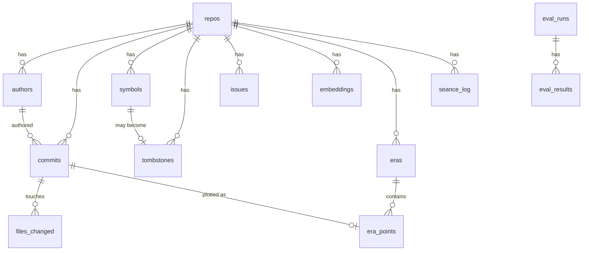

# Necropsy: Backend Data Schema

**Status:** Draft v0.1 · **Date:** 2026-10-31 · Companion docs: `TRD.md`, `ARCHITECTURE.md`

Database: **SQLite**, single file at `DATA_DIR/necropsy.db`.

---

## 1. Conventions

- **Dates:** all timestamps are UTC, stored as ISO-8601 text (`2024-03-09T14:05:00Z`). ISO-8601 strings sort correctly as text, so range filters and indexes work without conversion.
- **Time-travel filter:** `as_of` is the end of the selected day in UTC. Queries use `authored_at <= :as_of_end` (or `item_at <= :as_of_end` for embeddings).
- **Time basis:** `authored_at` is used for filtering. `committed_at` is stored for reference only.
- **Privacy:** raw author emails are never stored; only `sha256(lowercase(email))`.
- **Multi-repo:** every table carries `repo_id`, so one database can hold several repos.
- **Foreign keys:** enabled with `PRAGMA foreign_keys = ON;` on every connection.
- **Migrations:** `meta.schema_version` records the version; changes ship as numbered migration scripts.

## 2. Entity relationship overview



## 3. DDL

```sql
PRAGMA foreign_keys = ON;

-- ---------------------------------------------------------------
-- meta: schema version and small key/value settings
-- ---------------------------------------------------------------
CREATE TABLE meta (
    key   TEXT PRIMARY KEY,
    value TEXT NOT NULL
);
-- INSERT INTO meta VALUES ('schema_version', '1');

-- ---------------------------------------------------------------
-- repos: one row per analyzed repository
-- ---------------------------------------------------------------
CREATE TABLE repos (
    id              INTEGER PRIMARY KEY,
    name            TEXT NOT NULL,
    source          TEXT NOT NULL,              -- URL or local path as given by the user
    local_path      TEXT NOT NULL,              -- where the clone lives
    default_branch  TEXT,
    head_sha        TEXT NOT NULL,
    first_commit_at TEXT NOT NULL,
    last_commit_at  TEXT NOT NULL,
    commit_count    INTEGER NOT NULL,
    ingested_at     TEXT NOT NULL,
    status          TEXT NOT NULL
                    CHECK (status IN ('pending','ingesting','indexing','ready','failed')),
    progress        REAL NOT NULL DEFAULT 0,    -- 0.0 to 1.0, for the UI
    error           TEXT,
    UNIQUE (source)
);

-- ---------------------------------------------------------------
-- authors: people (or bots) who committed; emails hashed
-- ---------------------------------------------------------------
CREATE TABLE authors (
    id           INTEGER PRIMARY KEY,
    repo_id      INTEGER NOT NULL REFERENCES repos(id) ON DELETE CASCADE,
    display_name TEXT NOT NULL,
    email_hash   TEXT NOT NULL,                 -- sha256 of lowercased email
    is_bot       INTEGER NOT NULL DEFAULT 0 CHECK (is_bot IN (0,1)),
    UNIQUE (repo_id, email_hash)
);

-- ---------------------------------------------------------------
-- commits
-- ---------------------------------------------------------------
CREATE TABLE commits (
    repo_id             INTEGER NOT NULL REFERENCES repos(id) ON DELETE CASCADE,
    hash                TEXT NOT NULL,
    author_id           INTEGER NOT NULL REFERENCES authors(id),
    authored_at         TEXT NOT NULL,          -- UTC ISO-8601; the time-travel axis
    committed_at        TEXT NOT NULL,
    subject             TEXT NOT NULL,          -- first line of the message
    body                TEXT NOT NULL DEFAULT '',
    additions           INTEGER NOT NULL DEFAULT 0,
    deletions           INTEGER NOT NULL DEFAULT 0,
    files_changed_count INTEGER NOT NULL DEFAULT 0,
    is_merge            INTEGER NOT NULL DEFAULT 0 CHECK (is_merge IN (0,1)),
    parents             TEXT NOT NULL DEFAULT '[]',   -- JSON array of parent hashes
    PRIMARY KEY (repo_id, hash)
);
CREATE INDEX idx_commits_time   ON commits (repo_id, authored_at);
CREATE INDEX idx_commits_author ON commits (repo_id, author_id, authored_at);

-- ---------------------------------------------------------------
-- files_changed: per-commit file changes
-- ---------------------------------------------------------------
CREATE TABLE files_changed (
    id          INTEGER PRIMARY KEY,
    repo_id     INTEGER NOT NULL,
    commit_hash TEXT NOT NULL,
    path        TEXT NOT NULL,                  -- path after the change (or the deleted path for 'D')
    old_path    TEXT,                           -- set for renames
    change_type TEXT NOT NULL CHECK (change_type IN ('A','M','D','R','C')),
    additions   INTEGER NOT NULL DEFAULT 0,
    deletions   INTEGER NOT NULL DEFAULT 0,
    FOREIGN KEY (repo_id, commit_hash) REFERENCES commits(repo_id, hash) ON DELETE CASCADE
);
CREATE INDEX idx_files_commit ON files_changed (repo_id, commit_hash);
CREATE INDEX idx_files_path   ON files_changed (repo_id, path);

-- ---------------------------------------------------------------
-- symbols: lifecycle of functions/classes/methods (tree-sitter)
-- ---------------------------------------------------------------
CREATE TABLE symbols (
    id           INTEGER PRIMARY KEY,
    repo_id      INTEGER NOT NULL REFERENCES repos(id) ON DELETE CASCADE,
    file_path    TEXT NOT NULL,
    name         TEXT NOT NULL,
    kind         TEXT NOT NULL CHECK (kind IN ('function','class','method')),
    language     TEXT NOT NULL,
    signature    TEXT,
    born_commit  TEXT NOT NULL,
    born_at      TEXT NOT NULL,
    died_commit  TEXT,                          -- NULL while the symbol is alive at HEAD
    died_at      TEXT,
    UNIQUE (repo_id, file_path, name, kind, born_commit)
);
CREATE INDEX idx_symbols_life ON symbols (repo_id, born_at, died_at);

-- ---------------------------------------------------------------
-- tombstones: materialized view of deleted files and symbols
-- ---------------------------------------------------------------
CREATE TABLE tombstones (
    id             INTEGER PRIMARY KEY,
    repo_id        INTEGER NOT NULL REFERENCES repos(id) ON DELETE CASCADE,
    kind           TEXT NOT NULL CHECK (kind IN ('file','symbol')),
    path           TEXT NOT NULL,
    name           TEXT,                        -- NULL for files
    symbol_id      INTEGER REFERENCES symbols(id),
    born_commit    TEXT NOT NULL,
    born_at        TEXT NOT NULL,
    died_commit    TEXT NOT NULL,
    died_at        TEXT NOT NULL,
    died_author_id INTEGER REFERENCES authors(id),
    epitaph        TEXT NOT NULL,               -- subject of the deleting commit, verbatim
    lifespan_days  INTEGER NOT NULL
);
CREATE INDEX idx_tomb_died ON tombstones (repo_id, died_at);
CREATE INDEX idx_tomb_born ON tombstones (repo_id, born_at);

-- ---------------------------------------------------------------
-- issues (P2): cached issue data
-- ---------------------------------------------------------------
CREATE TABLE issues (
    id               INTEGER PRIMARY KEY,
    repo_id          INTEGER NOT NULL REFERENCES repos(id) ON DELETE CASCADE,
    number           INTEGER NOT NULL,
    title            TEXT NOT NULL,
    body             TEXT NOT NULL DEFAULT '',
    author_login     TEXT,
    created_at       TEXT NOT NULL,
    closed_at        TEXT,
    last_activity_at TEXT,
    comment_count    INTEGER NOT NULL DEFAULT 0,
    UNIQUE (repo_id, number)
);
CREATE INDEX idx_issues_time ON issues (repo_id, created_at);
-- State as of a date: open if created_at <= as_of AND (closed_at IS NULL OR closed_at > as_of).

-- ---------------------------------------------------------------
-- embeddings: one vector per indexed item
-- ---------------------------------------------------------------
CREATE TABLE embeddings (
    id        INTEGER PRIMARY KEY,
    repo_id   INTEGER NOT NULL REFERENCES repos(id) ON DELETE CASCADE,
    item_type TEXT NOT NULL CHECK (item_type IN ('commit','issue','doc')),
    item_ref  TEXT NOT NULL,                    -- commit hash | issue number | "path@commit"
    item_at   TEXT NOT NULL,                    -- date used for time-travel filtering
    text_hash TEXT NOT NULL,                    -- sha256 of the embedded text (skip re-embedding)
    model     TEXT NOT NULL,                    -- embedding model name + version
    dim       INTEGER NOT NULL,
    vector    BLOB NOT NULL,                    -- float32, L2-normalised, dim * 4 bytes
    UNIQUE (repo_id, item_type, item_ref, model)
);
CREATE INDEX idx_emb_time ON embeddings (repo_id, model, item_at);

-- ---------------------------------------------------------------
-- eras: clusters of project history (DISPLAY ONLY, never sent to the ghost)
-- ---------------------------------------------------------------
CREATE TABLE eras (
    id           INTEGER PRIMARY KEY,
    repo_id      INTEGER NOT NULL REFERENCES repos(id) ON DELETE CASCADE,
    idx          INTEGER NOT NULL,              -- ordering by start date
    label        TEXT,                          -- LLM-written, short
    summary      TEXT,
    start_at     TEXT NOT NULL,
    end_at       TEXT NOT NULL,
    commit_count INTEGER NOT NULL,
    algo         TEXT NOT NULL,                 -- e.g. 'kmeans' | 'hdbscan'
    params       TEXT NOT NULL DEFAULT '{}',    -- JSON
    model        TEXT NOT NULL,                 -- embedding + labeling model used
    UNIQUE (repo_id, idx)
);

CREATE TABLE era_points (
    repo_id     INTEGER NOT NULL,
    commit_hash TEXT NOT NULL,
    era_id      INTEGER NOT NULL REFERENCES eras(id) ON DELETE CASCADE,
    x           REAL NOT NULL,                  -- UMAP 2D coordinates
    y           REAL NOT NULL,
    PRIMARY KEY (repo_id, commit_hash),
    FOREIGN KEY (repo_id, commit_hash) REFERENCES commits(repo_id, hash) ON DELETE CASCADE
);

-- ---------------------------------------------------------------
-- seance_log: audit trail and cache of ghost answers
-- ---------------------------------------------------------------
CREATE TABLE seance_log (
    id              INTEGER PRIMARY KEY,
    repo_id         INTEGER NOT NULL REFERENCES repos(id) ON DELETE CASCADE,
    as_of           TEXT NOT NULL,
    question        TEXT NOT NULL,
    config_hash     TEXT NOT NULL,              -- models + thresholds that produced the answer
    llm_model       TEXT NOT NULL,
    evidence_hashes TEXT NOT NULL,              -- JSON array of commit hashes shown to the model
    raw_response    TEXT,                       -- model output before verification
    final_response  TEXT NOT NULL,              -- JSON after verification
    claims_total    INTEGER NOT NULL,
    claims_kept     INTEGER NOT NULL,
    latency_ms      INTEGER,
    created_at      TEXT NOT NULL
);
CREATE INDEX idx_seance_cache ON seance_log (repo_id, as_of, config_hash);

-- ---------------------------------------------------------------
-- evaluation harness
-- ---------------------------------------------------------------
CREATE TABLE eval_runs (
    id         INTEGER PRIMARY KEY,
    repo_id    INTEGER NOT NULL REFERENCES repos(id) ON DELETE CASCADE,
    llm_model  TEXT NOT NULL,
    config     TEXT NOT NULL,                   -- JSON: full config at run time
    started_at TEXT NOT NULL,
    finished_at TEXT
);

CREATE TABLE eval_results (
    id              INTEGER PRIMARY KEY,
    run_id          INTEGER NOT NULL REFERENCES eval_runs(id) ON DELETE CASCADE,
    category        TEXT NOT NULL,              -- last_modified | deleted_when | commit_change | symbol_alive
    as_of           TEXT NOT NULL,
    question        TEXT NOT NULL,
    expected        TEXT NOT NULL,
    got             TEXT,
    answer_correct  INTEGER CHECK (answer_correct IN (0,1)),
    citations_valid_before_verify REAL,         -- share of citations valid before pruning (0..1)
    citations_valid_after_verify  REAL,         -- should be 1.0 always
    latency_ms      INTEGER
);
```

## 4. Table notes

| Table | Notes |
|---|---|
| `repos.status` | Drives the UI progress bar. Re-ingesting the same `source` updates the row and replaces dependent data in one transaction. |
| `commits.parents` | Kept as JSON for simplicity; the DAG is not queried relationally in the MVP. |
| `symbols` | A symbol can die and be reborn (same name, later `born_commit`); uniqueness includes `born_commit`. |
| `tombstones` | Rebuilt from `files_changed` (`change_type = 'D'`) and `symbols` (`died_commit IS NOT NULL`) at the end of ingest. Cheap to regenerate. |
| `embeddings.vector` | Stored as raw `float32` bytes. Load with `np.frombuffer(blob, dtype=np.float32)`. |
| `embeddings.model` | Prevents mixing vectors from different embedding models. Changing the model means re-indexing. |
| `eras` / `era_points` | Cluster assignments depend on all commits. Treat as presentation data. Never include in prompts. |
| `seance_log` | Doubles as a cache: same `(repo_id, as_of, question, config_hash)` returns the stored answer. |

## 5. Time-travel query patterns

Commit activity as of a date:

```sql
SELECT strftime('%Y-%W', authored_at) AS week, COUNT(*) AS commits
FROM commits c
JOIN authors a ON a.id = c.author_id
WHERE c.repo_id = :repo AND c.authored_at <= :as_of_end
  AND c.is_merge = 0 AND a.is_bot = 0
GROUP BY week ORDER BY week;
```

Graveyard as of a date (items already dead at that time):

```sql
SELECT kind, path, name, born_at, died_at, epitaph, lifespan_days
FROM tombstones
WHERE repo_id = :repo AND died_at <= :as_of_end
ORDER BY died_at DESC;
```

Items alive at a date (born, not yet dead):

```sql
SELECT file_path, name, kind
FROM symbols
WHERE repo_id = :repo AND born_at <= :as_of_end
  AND (died_at IS NULL OR died_at > :as_of_end);
```

Loading embeddings for the in-memory, date-sorted matrix (done once per repo and model):

```sql
SELECT item_ref, item_at, vector
FROM embeddings
WHERE repo_id = :repo AND model = :model AND item_type = 'commit'
ORDER BY item_at;
```

At query time the prefix length for a given `as_of` is found with a binary search over the sorted `item_at` list (see `TRD.md` §6.2 and §7).

Bus factor inputs (lines changed per author in the 12 months before the date):

```sql
SELECT a.id, a.display_name, SUM(c.additions + c.deletions) AS churn
FROM commits c JOIN authors a ON a.id = c.author_id
WHERE c.repo_id = :repo AND a.is_bot = 0
  AND c.authored_at <= :as_of_end AND c.authored_at > :window_start
GROUP BY a.id ORDER BY churn DESC;
```

## 6. Data lifecycle

1. `POST /exhume` inserts or updates the `repos` row (`pending` → `ingesting`).
2. Ingest fills `authors`, `commits`, `files_changed`, then `symbols`, then derives `tombstones`.
3. Index fills `embeddings` (`indexing`), then optionally `eras` and `era_points`.
4. `status = 'ready'`. Autopsy, graveyard and séance endpoints become available.
5. Séance calls append to `seance_log`. Eval runs append to `eval_runs` and `eval_results`.
6. Deleting a repo cascades to every dependent table.

## 7. Sizing

| Item | Approx. size for 2,000 commits |
|---|---|
| Commits + files + authors | a few MB |
| Embeddings (384 dims × 4 bytes) | ≈ 3 MB |
| Symbols/tombstones | < 1 MB |
| Whole DB | typically < 20 MB |

Brute-force similarity is comfortable up to roughly 50,000 vectors; beyond that, add an approximate index (FAISS) behind the same `retrieve()` interface.

## 8. Integrity rules (enforced in code and tests)

- No row in `embeddings` without a matching source item.
- `tombstones.died_at >= tombstones.born_at`.
- Every hash in `seance_log.evidence_hashes` exists in `commits` and is dated ≤ that row's `as_of`.
- Every citation in `final_response` is a member of `evidence_hashes`.
- `eras` rows are never read by `ghost/*` modules (enforced by an import-boundary test).
