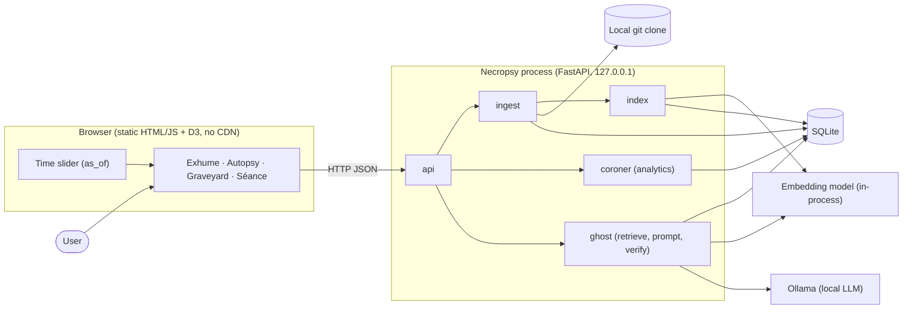
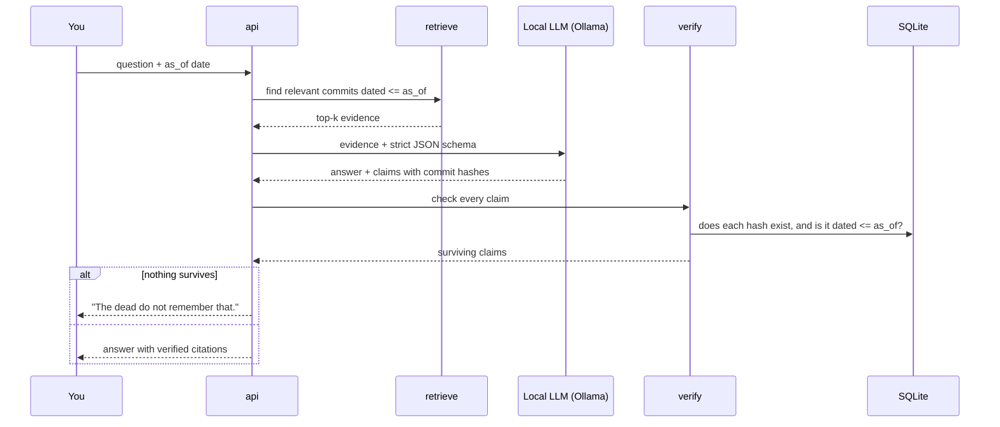

# 🪦 Necropsy

### Hold a séance with any dead repository.

Necropsy performs an **autopsy** on an abandoned Git repository (when it died, how it declined, what code was lost) and opens a **séance**: a chat with the project's ghost, which can only answer from what existed on the date you pick. Every claim cites real commits, and anything that can't be verified is removed.

**Everything runs locally on open-weight models. After the first clone, it works with the network unplugged.**

Built for the Hacktoberfest **"Ghost in the Machine"** open-source AI challenge.

> **Status:** in development. Items under [Roadmap](#roadmap) show what is done. Commands in this README describe the planned interface; adjust them to the final `Makefile`.

<!-- Replace with a real recording once the UI works -->
<!--  -->

---

## Contents

1. [Why this exists](#why-this-exists)
2. [What you can do](#what-you-can-do)
3. [How it works, in plain English](#how-it-works-in-plain-english)
4. [Architecture](#architecture)
5. [The idea that makes it different: time travel](#the-idea-that-makes-it-different-time-travel)
6. [Concepts explained](#concepts-explained)
7. [Models](#models)
8. [Quickstart](#quickstart)
9. [Project structure](#project-structure)
10. [Why open-source AI matters here](#why-open-source-ai-matters-here)
11. [Evaluation](#evaluation)
12. [Limitations](#limitations)
13. [Roadmap](#roadmap)
14. [Ethics](#ethics)
15. [Documentation](#documentation)
16. [Contributing](#contributing)
17. [License](#license)

---

## Why this exists

Abandoned repositories hold years of decisions that nobody can easily recover:

- *Why* was that feature removed? A design choice, or a casualty of burnout?
- What did the project look like at its peak?
- Is it worth reviving, and where would you start?

Most "chat with your repo" tools treat history as a flat pile of text. They have no sense of time, they confidently make things up, and many send your code to a closed API, which rules out private or proprietary projects.

Necropsy treats a repository as something that **lived and died over time**, and it refuses to say anything it can't back up with a commit.

## What you can do

| Screen | What it shows |
|---|---|
| **Exhume** | Paste a repo URL or local path and watch it get indexed |
| **Autopsy** | Time of death, last-gasp commit, weekly activity, bus factor, project "eras" |
| **Graveyard** | Tombstones for deleted files and functions, each with the deleting commit's message as its epitaph |
| **Séance** | Ask the ghost questions; click any citation to read the commit behind it |
| **Time slider** | Drag to a past date and *everything* rewinds: the stats, the graveyard, and what the ghost knows |
| **Resurrection plan** | Export a Markdown report: what to fix first, stale dependencies, suggested first tasks |

When the evidence isn't there, the ghost says so:

> *"The dead do not remember that."*

## How it works, in plain English

1. **Exhume.** Necropsy reads the repo's Git history (commits, authors, changed files) into a small SQLite database. Deleted files and functions become **tombstones**.
2. **Embed.** Each commit's text is turned into a list of numbers (an *embedding*) by a small local model, so commits with similar meaning end up close together.
3. **Choose a date.** The slider sets an `as_of` date. Nothing newer than that exists as far as the app is concerned.
4. **Retrieve.** When you ask a question, Necropsy finds the commits closest in meaning to it, *only among commits up to that date*.
5. **Answer.** A local language model writes an answer in the project's voice, using only those commits, and must cite them.
6. **Verify.** Code (not the model) checks each citation: does the commit exist, is it dated before `as_of`, was it in the evidence, does it actually support the claim? Unsupported claims are deleted.

The numbers in the autopsy (time of death, bus factor, activity) come from ordinary deterministic code, never from the language model.

## Architecture



### What happens when you ask the ghost a question



### Components

| Component | Job |
|---|---|
| `ingest` | Reads Git history; builds tombstones with tree-sitter |
| `index` | Embeds commit text; stores vectors sorted by date |
| `coroner` | Deterministic analytics: activity, last gasp, time of death, bus factor, eras |
| `ghost` | Retrieval, prompt construction, LLM call, citation verification |
| `api` | FastAPI endpoints and input validation |
| `web` | Static UI with D3 charts and the time slider |
| `evals` | Measures answer accuracy and citation validity per model |

See [`docs/ARCHITECTURE.md`](docs/ARCHITECTURE.md) for the full design and [`docs/DATA_SCHEMA.md`](docs/DATA_SCHEMA.md) for the database.

## The idea that makes it different: time travel

The core promise is that **nothing dated after the selected date can reach the model.** The design makes that structural rather than a filter you hope you remembered:

- Commit vectors are stored **sorted by date**. "Everything up to `as_of`" is a *prefix* of that list, found by binary search, so later commits are never even in the set that gets scored. (Filtering *after* ranking would let future commits influence which results come back.)
- The prompt is built only from the retrieved evidence.
- The verifier rejects any citation dated after `as_of` or not in the evidence shown to the model.
- Project "eras" are computed from the entire history, so they depend on the future. They are a **display-only** layer and are never shown to the ghost.
- A mandatory automated test builds a fixture repo with known dates and checks every layer for several `as_of` values.

## Concepts explained

Short intuitions for the ideas this project is built on. They connect more than they seem to.

**Embeddings.** A model reads text and outputs a point in a high-dimensional space (here 384 dimensions) so that texts with similar meaning land near each other. "Fix crash on empty config" and "handle missing configuration file" end up neighbors even though they share few words.

**Cosine similarity.** Closeness between two embeddings is the angle between them. If vectors are normalized to length 1, similarity is just a dot product, which is why retrieval here is a single matrix multiplication.

**Retrieval-augmented generation (RAG).** Instead of letting a language model answer from its fuzzy memory, you first retrieve relevant evidence and force it to answer from that. Necropsy adds two things most RAG demos skip: a **time boundary** on retrieval and a **verifier** after generation.

**Structured output.** The model is constrained to return JSON matching a schema (`remembers`, `answer`, `claims[]`). That turns free text into data that code can check.

**Why verify in code?** Small local models sometimes cite things that don't exist. Checking hashes, dates and support in ordinary code is cheap, deterministic and can't be sweet-talked.

**Clustering ("eras").** Commit embeddings are grouped (KMeans or HDBSCAN) and projected to 2D (UMAP). Dense groups are phases of work, such as "plugin system" or "maintenance mode". This is unsupervised learning applied to the same representation that powers retrieval.

**Deterministic analytics.** Time of death, decline onset and bus factor are formulas over commit data. Using the LLM for numbers would make them unreproducible, so it only explains them.

## Models

| Role | Default | Fallback (8 GB RAM) | Why |
|---|---|---|---|
| Ghost / narrator | `qwen3:8b` | `qwen3:4b` | Follows structured-output instructions and writes grounded explanations |
| Code-aware summaries (optional) | `qwen2.5-coder:7b` | n/a | Better at explaining *why* a diff was made |
| Embeddings | `BAAI/bge-small-en-v1.5` | same | Small, fast on CPU, strong retrieval quality |
| Entailment check (optional, off by default) | small NLI model | n/a | Stricter citation checking |

Model names are pinned in `necropsy/config.py` and can be changed with environment variables. **Check each model's license before pinning or redistributing.**

## Quickstart

**Requirements:** Python 3.11+, Git, [Ollama](https://ollama.com), about 16 GB RAM (CPU is fine; GPU is optional).

```bash
# 1. Get the code
git clone https://github.com/<you>/necropsy.git
cd necropsy

# 2. Pull the local models (one-time, needs network)
ollama pull qwen3:8b
ollama pull qwen2.5-coder:7b        # optional

# 3. Install
python -m venv .venv && source .venv/bin/activate
pip install -e .

# 4. Run
make run
# open http://127.0.0.1:8000
```

Then paste a repository URL (or a local path) into **Exhume** and wait for indexing to finish. After that you can disconnect from the network.

On a smaller machine:

```bash
ollama pull qwen3:4b
NECROPSY_LLM_MODEL=qwen3:4b make run
```

Other commands:

```bash
make test     # unit tests, including the date-leak test
make eval     # run the evaluation harness and print the results table
make demo     # index the bundled example repo
```

## Project structure

```text
necropsy/
├── README.md  CONTRIBUTING.md  LICENSE  Makefile  pyproject.toml
├── docs/        PRD · TRD · ARCHITECTURE · DATA_SCHEMA · API · UX · WHY_OPEN · EVALS
├── necropsy/
│   ├── config.py                      # pinned models and settings
│   ├── ingest/    git.py symbols.py issues.py
│   ├── index/     embed.py store.py
│   ├── coroner/   activity.py busfactor.py eras.py tombstones.py
│   ├── ghost/     retrieve.py prompt.py verify.py llm.py
│   ├── api/       server.py schemas.py
│   └── evals/     generate.py run.py
├── web/           index.html app.js graveyard.js timeline.js vendor/ style.css
├── tests/         fixtures/ test_dateleak.py test_verify.py ...
└── examples/      sample autopsy output
```

## Why open-source AI matters here

The open models aren't a convenience in this project; the design depends on them.

- **Offline operation.** The whole pipeline (embedding, retrieval, generation, verification) runs on your machine. Clone once, then unplug.
- **Privacy for private dead repos.** Old company code and unreleased side projects can't be pasted into a closed service. Necropsy never has to send them anywhere.
- **No per-request cost.** Indexing thousands of commits and asking unlimited questions costs electricity, not API credits.
- **Swappable models.** The model is a replaceable part. Change one setting to compare an 8B model with a 4B one, or swap in a future model; the evaluation harness measures the difference.
- **Reproducibility and preservation.** Pinned open weights mean an autopsy produced today can be reproduced years from now. A hosted model that is updated or retired behind the scenes can't offer that, which matters for a tool about preserving history.
- **Customization.** Because you control the model, you can adapt it, for example by fine-tuning on a project's own vocabulary, without asking anyone's permission.

## Evaluation

The `make eval` command generates questions whose answers come from Git itself (who last modified a file, when something was deleted, what a commit changed) and scores each configured model on **answer accuracy** and **citation validity**.

Results (to be filled in after the first real run; do not publish numbers you didn't measure):

| Model | Answer accuracy | Citations valid before verification | Citations valid after verification |
|---|---|---|---|
| `qwen3:8b` | _tbd_ | _tbd_ | _tbd_ |
| `qwen3:4b` | _tbd_ | _tbd_ | _tbd_ |

Citation validity after verification should be 100% by construction. Answer accuracy is the honest, interesting number.

## Limitations

- **Heuristics, not facts.** "Time of death" and "bus factor" are documented approximations.
- **Evidence-limited.** If commit messages are uninformative, the ghost has little to work with.
- **Small models make mistakes.** Verification removes unsupported citations, but it can't fully catch an inference that merely resembles a cited commit.
- **Limited language support** for symbol tracking; a rename inside a file is recorded as a death plus a birth.
- **Rewritten history** (force pushes, squashed repos) limits what any tool can recover.
- **Issues and discussions** are only included if imported.

## Roadmap

- [ ] Ingest commits, authors and files into SQLite
- [ ] Embeddings and date-sorted retrieval
- [ ] Ghost with schema-constrained output and citation verification
- [ ] Autopsy analytics and the time slider
- [ ] Tombstones and the graveyard
- [ ] Eras map
- [ ] Resurrection plan export
- [ ] Evaluation harness
- [ ] Issue ingestion
- [ ] Tool-using ghost (read-only git commands)
- [ ] Reincarnation finder (link a deleted function to its closest living relative)
- [ ] Voice séance
- [ ] LoRA fine-tune compared with plain retrieval

## Ethics

- The ghost speaks **as the project**. It quotes real commit messages verbatim and never impersonates a named maintainer.
- Contributor emails are stored only as hashes.
- Necropsy is read-only: it never modifies the analyzed repository, opens pull requests, or executes its code.
- Analytics describe *activity*, not people's mental state.

## Documentation

| Document | What it covers |
|---|---|
| [`docs/PRD.md`](docs/PRD.md) | Product goals, users, requirements, metrics |
| [`docs/TRD.md`](docs/TRD.md) | Technical choices, algorithms, security, tests |
| [`docs/ARCHITECTURE.md`](docs/ARCHITECTURE.md) | Components, data flow, how time-travel is enforced |
| [`docs/DATA_SCHEMA.md`](docs/DATA_SCHEMA.md) | SQLite schema and query patterns |

## Contributing

Contributions are welcome, especially during Hacktoberfest. Good first issues:

- Add tree-sitter symbol support for another language
- Improve the bot-detection patterns
- Add a new eval question category
- Improve the UI's accessibility (keyboard navigation for the time slider)
- Add a reranker behind the config flag

Please read `CONTRIBUTING.md`, run `make test` (the date-leak test must pass), and keep changes small. Hand-written, reviewed pull requests only; no bulk or automated PRs.

## License

MIT for this project. Models are used under their own licenses; check them before redistributing.

---

<sub>Built for Hacktoberfest "Ghost in the Machine". Every ghost needs a good epitaph.</sub>
